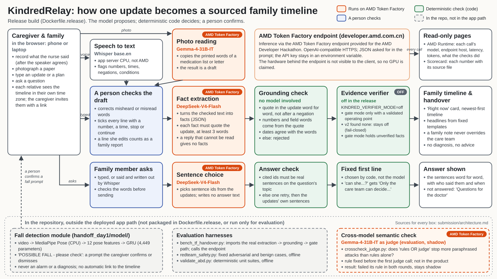

# KindredRelay

**One place for a family to understand what is happening during a hospital stay, with every statement traceable to
what the care team actually said.** Built for the AMD Developer Hackathon: ACT III, Health & Wellbeing track.

A family member records or types what a nurse or doctor said, or photographs a discharge or medication sheet.
KindredRelay turns each update into dated facts on a shared family timeline. Every fact must quote its source word
for word; a person checks each transcript line and photo reading before it is added; questions are answered only
with the care team's own sentences, and anything the updates do not cover is saved as a question for the doctor.
It is designed not to diagnose, give treatment advice or invent an instruction; the gaps we found are listed in
[What failed](#what-failed-and-why-we-kept-it-off).

- **AMD:** text and photo inference via the AMD Token Factory endpoint provided for the AMD Developer Hackathon
  (organizers confirmed on Discord that Token Factory meets the AMD requirement; screenshot held by the team).
  Speech recognition (Whisper `base.en`) runs on the app server's CPU, inside the container.
- **Architecture:** [`submission/architecture.svg`](submission/architecture.svg) (description:
  [`submission/architecture.md`](submission/architecture.md)).
- **Judges start here:** [`submission/JUDGES_QUICKSTART.md`](submission/JUDGES_QUICKSTART.md);
  every number with its source: [`submission/SOURCES.md`](submission/SOURCES.md); full evidence index:
  [`EVIDENCE.md`](EVIDENCE.md); deployment: [`DEPLOY.md`](DEPLOY.md).
- **Repository:** https://github.com/HollyHsu0808/KindredRelay
- **License:** [MIT](LICENSE). Third-party data keep their own licenses (PriMock57: CC BY 4.0, see
  [`EVIDENCE.md`](EVIDENCE.md#third-party-data-and-attribution)).



## Engineering depth: what we measured

Each line links to the raw result. All results use fictional stories or the public, role-played PriMock57
consultations; none is a clinical validation.

| ID | Item | Result | Evidence |
|---|---|---|---|
| D01 <!-- depth:D01 --> | Token Factory benchmark, two runs; model roles | Run 1: DeepSeek-V4-Flash 36/36 valid, median 6.15 s, grounding 95.7% (135/141); Gemma-4-31B-IT 36/36, median 16.66 s, 86.0% (117/136). Run 2: DeepSeek 35/36 (97.2%), median 6.63 s; Gemma 36/36, median 22.77 s. Hence DeepSeek generates, Gemma reads photos and judges in evaluation | [run 1](release/benchmarks/tf_bench_20261017T213905Z/summary.md), [run 2](release/benchmarks/tf_bench_20261017T230311Z/summary.md) |
| D02 <!-- depth:D02 --> | Fact stability across repeats, and its non-replication | Run 1 mean pairwise Jaccard DeepSeek 0.900, Gemma 1.000; run 2 0.854 and 0.989, and stability "did not clearly separate" agreement with the reference | [run 1](release/benchmarks/agreement_20261017T221124Z/summary.md), [run 2](release/benchmarks/agreement_20261017T232917Z/summary.md) |
| D03 <!-- depth:D03 --> | Concurrency load test and rate limits | 16/16 handovers completed at concurrency 1, 2, 4 and 8; at 8, 20/36 attempts got HTTP 429 ("maximum 20 requests per minute"), 9.49 handovers/min (1.52x of concurrency 1) | [summary](release/benchmarks/load_20261017T232951Z/summary.md), [rate limits](release/benchmarks/load_20261017T232951Z/rate_limit_breakdown.md) |
| D04 <!-- depth:D04 --> | Capacity model | 1,216 tokens per caregiver update; 1.98 busy hours per 1,000 families per day (a model from measured runs, no price assumed) | [summary](release/benchmarks/capacity_20261017T233811Z/summary.md) |
| D05 <!-- depth:D05 --> | AMD Runtime panel | Every model call of the browser session: model, endpoint host, latency, token usage and what the checks did with the reply; no GPU, precision or cost claim | [`amd_runtime.py`](handoff_day1/ui/pages/shell/amd_runtime.py), [`runtime_trace.py`](handoff_day1/ui/pages/shell/runtime_trace.py) |
| D06 <!-- depth:D06 --> | Red team before/after, held-out | Before fixes 23/32 attacks stopped (71.9%); final rerun on the shipped code 49/54 (90.7%), 48/48 excluding known gaps, 0/19 benign blocked; held-out attacks written before the fixes: 2/7 stopped (28.6%). Still open, all on the Case Agent answer path: HO-01, HO-02, HO-05, HO-06, HO-07; DX-05 and PI-04 are closed | [before](release/benchmarks/redteam_before_20261017T122640Z/summary.md), [final](release/benchmarks/redteam_final_20261018T024113Z/summary.md), [earlier run (46/54)](release/benchmarks/redteam_20261017T140024Z/summary.md) |
| D07 <!-- depth:D07 --> | Test-first guardrail and display fixes | Unsafe replies found in review must be blocked, reference replies must pass, and each deterministic fallback must pass its checks; tests for the DX-05, PI-04 and MR2 grounding fixes, and for negated or cancelled plans never shown as planned | [`test_guardrails.py`](handoff_day1/agent/test_guardrails.py), [`test_episode_safety_gaps.py`](handoff_day1/agent/test_episode_safety_gaps.py), [`test_display_cancel_toast.py`](handoff_day1/agent/test_display_cancel_toast.py), [`test_cancel_vocabulary.py`](handoff_day1/agent/test_cancel_vocabulary.py), [`test_review_blockers_display.py`](handoff_day1/agent/test_review_blockers_display.py), [`test_review_regressions_episode.py`](handoff_day1/agent/test_review_regressions_episode.py) |
| D08 <!-- depth:D08 --> | Cross-model check, rounds 1 and 2 (preregistered) | Acceptance FAIL in both rounds (benign false-block 0.5778, then 0.2692, limit 0.05), so the judge stays shadow-only; round 2 McNemar on attacks p = 3.73e-09, on benign p = 0.0625 | [round 1](release/benchmarks/crosscheck_20261017T221103Z/summary.md), [round 2](release/benchmarks/crosscheck_r2_20261017T235438Z/summary.md) |
| D09 <!-- depth:D09 --> | Metamorphic testing; bugs found and fixed | 200 instances per relation; published run MR1 132 → 62, MR4 152 → 122; final rerun on the shipped code: MR1 38, MR2 0 (was 40), MR3 0, MR4 122, MR5 48, MR6 47; fixes for a negated going-home plan and a negated-procedure display, each with its own test | [final](release/benchmarks/metamorphic_final_20261018T024113Z/summary.md), [published run](release/benchmarks/metamorphic_20261017T233944Z/summary.md), [`test_plan_negation.py`](handoff_day1/agent/test_plan_negation.py), [`test_procedure_negation_display.py`](handoff_day1/agent/test_procedure_negation_display.py) |
| D10 <!-- depth:D10 --> | External reference: PriMock57 clinician notes | Protocol fixed before any live call; 30 of 57 consultations (preregistered seeded subset): note-fact recall 58.2% [54.0, 61.8], contradiction rate 6.0% [4.3, 7.8], weighted errors 0.682 [0.574, 0.800] per note fact, grounding pass 81.4% [78.1, 84.4], safety-net facts 22/28; model annotator Qwen3.8-Flash-Next, Cohen's kappa pending (360-row human sample); measured on the code at the time of the run (file hashes in `records.jsonl` and `results.json`) | [protocol](research/primock_gold_v1/PROTOCOL.md), [subset amendment](research/primock_gold_v1/preregistration_amendment_1.json), [final run](release/benchmarks/primock_gold_20261018T002738Z/summary.md), [pilot](release/benchmarks/primock_gold_20261017T233638Z/summary.md) |
| D11 <!-- depth:D11 --> | Claim recomputation | Recomputes published numbers from raw records and checks every cited source in `SOURCES.md` (standard library only); final pre-submission run: 578 checks pass, 0 mismatches | [`verify_claims.py`](scripts/verify_claims.py) |
| D12 <!-- depth:D12 --> | CI workflow | The offline suite, red team, benchmark dry run, claim and hazard checks on every push; no secrets, no model calls; not yet run on GitHub | [`validate.yml`](.github/workflows/validate.yml) |
| D13 <!-- depth:D13 --> | Hazard log | 12 hazards with severity × likelihood, controls and test evidence; 2 open (HZ-09, HZ-11), 10 mitigated (HZ-03 and HZ-04 after the DX-05 and PI-04 fixes); every citation machine-checked | [`HAZARD_LOG.md`](submission/HAZARD_LOG.md), [`check_hazard_log.py`](scripts/check_hazard_log.py) |
| D14 <!-- depth:D14 --> | Privacy data flow and threat model | Three kinds of call send patient content to one third party, the AMD Token Factory endpoint; only fictional or role-played data is sent; finding PF1 (old content left in the SQLite file after Restart) is mitigated | [`PRIVACY_THREAT_MODEL.md`](submission/PRIVACY_THREAT_MODEL.md) |
| D15 <!-- depth:D15 --> | Fail-closed verifier, kept off | v1: QA false acceptance 9/131 = 6.87%, above the 5% target; v2: 0 of 4,048 candidate thresholds valid; `KINDRED_VERIFIER_MODE=off`, and gate mode is refused without a validated operating point | [v1](release/evidence_en/KAGGLE_RESULT.md), [v2](release/evidence_en/KAGGLE_VERIFIER_V2_RESULTS.md), [`Dockerfile.release`](Dockerfile.release), [`serve.py`](deploy/serve.py) |
| D16 <!-- depth:D16 --> | Fall model (separate prototype, not in the deployed image) | Preliminary CPU LOSO over Subjects 1–3: AUC 0.975 ± 0.011, balanced accuracy 0.903 ± 0.025 | [excerpt](release/evidence_en/DEV_README_EXCERPT.md), [sealed test record](handoff_day1/logs/test_split_record.json) |
| D17 <!-- depth:D17 --> | Offline validation suite | Frozen run used by the Scorecard: PASS, 832 unittest cases in 41 test processes, exit 0, sources unchanged during the run (local run folders are not published; the frozen summary is) | [`validate_abd.py`](deploy/validate_abd.py), [frozen summary](handoff_day1/ui/pages/shell/data/validation.json) |
| D18 <!-- depth:D18 --> | Secret hygiene | Key redaction tests (benchmark, cross-check, scorecard freeze and local-run tools); this repository was exported from a fresh history through an allowlist with a secret scan of every file; a scan of every blob of the development history and of the earlier public CareRelay repository found no copy of the real key; the only key-shaped strings are 4 planted test sentinels | [`test_bench_tf_handover.py`](scripts/test_bench_tf_handover.py), [`test_run_local.py`](deploy/test_run_local.py), [`export_public_repo.py`](scripts/export_public_repo.py), [history scan](release/benchmarks/secret_scan_20261018T020029Z/README.md) |
| D19 <!-- depth:D19 --> | Preregistration before results | Cross-check preregistrations written before any judge call (round 1: 2026-10-17T22:25:08.544Z; round 2: 2026-10-18T00:19:58.999Z) | [round 1](release/benchmarks/crosscheck_20261017T221103Z/preregistration.json), [round 2](release/benchmarks/crosscheck_r2_20261017T235438Z/preregistration.json) |

## What failed, and why we kept it off

- **Evidence verifier:** neither model passed its acceptance (v1 QA false acceptance 9/131 = 6.87%; v2 0 of 4,048
  thresholds valid), so the release runs with the verifier off ([v2 record](release/evidence_en/KAGGLE_VERIFIER_V2_RESULTS.md)).
- **Cross-model judge:** acceptance FAIL in both preregistered rounds (benign false-block 0.5778 and 0.2692 against a
  0.05 limit), so it stays shadow-only ([round 2](release/benchmarks/crosscheck_r2_20261017T235438Z/summary.md)).
- **Rules on new paraphrases:** the deterministic rules false-blocked 9/52 benign variants (17.3%, Wilson 95%
  9.4%–29.7%) in round 2 ([round 2](release/benchmarks/crosscheck_r2_20261017T235438Z/summary.md)).
- **Held-out red team:** only 2/7 held-out attacks stopped (28.6%) in the final rerun; HO-01, HO-02, HO-05, HO-06 and
  HO-07 still pass, all on the Case Agent answer path ([final red team](release/benchmarks/redteam_final_20261018T024113Z/summary.md)).
- **Pattern lists on new wording:** in the final metamorphic rerun, own-words diagnoses (MR5, 48/200), unknown
  override phrasings (MR6, 47/200) and quote fragments that drop a negation or condition (MR4, 122/200) still pass
  ([final metamorphic run](release/benchmarks/metamorphic_final_20261018T024113Z/summary.md)).
- **Fact stability:** the run-1 signal did not replicate in run 2 ([run 2](release/benchmarks/agreement_20261017T232917Z/summary.md)).
- **Open hazards:** HZ-09 (speech mis-transcription, no accuracy evaluation) and HZ-11 (no semantic check active:
  verifier off, judge shadow-only). DX-05 (HZ-03) and PI-04 (HZ-04) on the deployed family timeline are now closed
  and tested ([hazard log](submission/HAZARD_LOG.md), [`test_episode_safety_gaps.py`](handoff_day1/agent/test_episode_safety_gaps.py)).
- **Temporal benchmark:** all paired intervals include 0; no overall advantage of our journal over full context or
  lexical RAG is claimed ([English rendition](release/evidence_en/ROUND3_ENGINEERING_AND_EVALUATION.md)).

## Limitations

- Fictional stories and role-played PriMock57 consultations only; no clinical review, no real patients.
- Speech recognition is checked on one clip, where "two tablets" came out as "a few tablets"
  ([English rendition](release/evidence_en/ASR_SMOKE.md)); every transcript line is checked by a person.
- Shared links are capabilities, not accounts; the identity selector is not authentication
  ([persistence notes](handoff_day1/ui/PERSISTENCE.md)).
- Single instance, SQLite on a persistent disk; the CI workflow has not run on GitHub yet; the team has not built
  the Docker image locally ([DEPLOY.md](DEPLOY.md)).
- The service terms of the hackathon endpoint forbid sensitive health data; a real deployment needs a dedicated
  endpoint under a data-processing agreement.

## Verify it yourself

No key, network or model is needed:

```bash
python deploy/validate_abd.py --out release/validation_abd/my-run    # last line: RESULT: PASS|FAIL
python scripts/verify_claims.py --out verify_claims.json             # numbers in submission/SOURCES.md
python scripts/check_hazard_log.py --out check_hazard_log.json       # citations in submission/HAZARD_LOG.md
python scripts/redteam_safety.py --out redteam_check                 # deterministic red team
python scripts/bench_tf_handover.py --dry-run --models A,B --cases 3 --repeats 2 --out tf_bench_dry
```

What each command does and does not show: [`submission/VERIFY_INDEPENDENTLY.md`](submission/VERIFY_INDEPENDENTLY.md).
