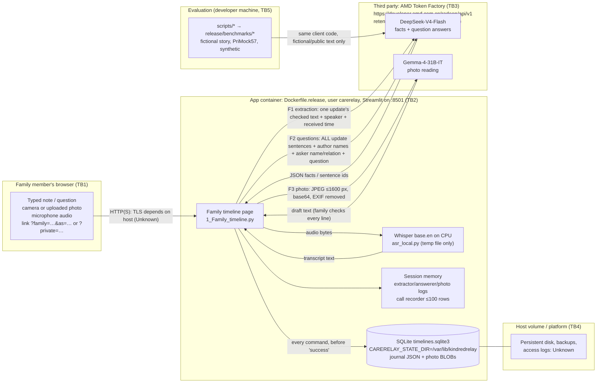

# KindredRelay: privacy data flow and threat model

**What this is.** This document describes what happens to patient and family data in the deployed KindredRelay path (`Dockerfile.release` → `deploy/serve.py` → `handoff_day1/ui/pages/shell/kindred_app.py` → the family timeline page). It also lists the threats at each trust boundary (STRIDE for security, LINDDUN for privacy), what is already in the code, what is missing, and what we would do next. KindredRelay is a hackathon prototype. It has handled only the fictional demo story, the public PriMock57 role-play consultations and synthetic red-team text. **It is not cleared for real patient data.**

**How to read it.** A statement about the system cites `path:line` ("short quote") for the code or document it was read from on 2026-10-18 between 00:32 and 00:45 UTC (git HEAD `0874ecd` plus uncommitted edits in the working tree). Each statement carries one of these labels:

- **VERIFIED**: read in the cited source, or seen in a local run listed in §13.
- **HYPOTHESIS**: plausible, but not tested.
- **Unknown**: not documented in the repository.
- **Not implemented**: the code does not do it.

Another session was editing `handoff_day1/agent/episode.py` while this was written. Its line numbers moved by +41 between 00:35 and 00:39 UTC and by +8 more by 00:44. Citations into that file are the 00:39 UTC line numbers plus the function name (`llm_extractor`, `photo_reader`, `SYSTEM`); search for the function to find the current line.

Regulatory notes (§10) are orientation for judges, not legal advice.

---

## 0. Summary for judges

1. **Three kinds of call send patient content to one third party, the AMD Token Factory endpoint (`developer.amd.com.cn`):**
   - fact extraction: one update's checked text;
   - question answering: every sentence of every update, plus the asker's name and relation;
   - photo reading: the photo itself.

   Speech recognition (Whisper `base.en`) runs inside the app container, so **audio never leaves it** (§2). VERIFIED.
2. **Retention by the third party.** The team-relayed Token Factory terms say the endpoint keeps prompts and outputs for about 2 days, is for trial and development only, and must not receive sensitive personal, health or financial data (`release/evidence_en/HACKATHON_RULES_BRIEFING.md:30`). These terms were relayed by the team and **not independently verified**. We follow them: only fictional and public data have been sent.
3. **Local storage.** One SQLite file holds every timeline, in plain JSON with photos as BLOBs. There is no encryption, no automatic expiry and no way to delete a family space (§3).
   - Access is by a 256-bit link token. Anyone holding a family link can view, change, impersonate any family member, invite others, or restart the story (`handoff_day1/ui/PERSISTENCE.md:21-25`). VERIFIED.
4. **Logs.** The runtime trace keeps call metadata only: no prompt, reply, image or key (`handoff_day1/agent/llm_client.py:25`). VERIFIED. The session's own working logs do hold prompt tails and reply text, in server memory for that browser session only (§4).
5. **Privacy findings PF1–PF6** (details in §2–§5 and §8; flows are numbered F0–F9 in §2, findings PF):
   - **PF1** MITIGATED. After "Restart", the replaced patient text and photo bytes were still readable inside the SQLite file (VERIFIED by local test T2). Every store connection now sets `PRAGMA secure_delete = ON` (`handoff_day1/ui/timeline_storage.py:75`), and T2 re-run prints `old text bytes still in file: False | old photo bytes still in file: False`. A database written before the change keeps earlier freed pages until one `VACUUM`.
   - **PF2** Lines a caregiver deletes from a photo or recording draft are still saved in `reading.model_text` / `removed_lines`. VERIFIED.
   - **PF3** Deleting an update keeps its original text and photo in the journal. VERIFIED.
   - **PF4** Four published evaluation files contain a developer's local Windows path, which includes the username. This is not patient data. VERIFIED.
   - **PF5** Every question sends the whole timeline to the endpoint, not only the sentences that answer it. VERIFIED.
   - **PF6** Recordings and typed notes go to the endpoint without the "sent to {host}" notice that questions and photos get, and the recording consent is not saved. VERIFIED.

---

## 1. Data inventory

| # | Data | Example in the demo (fictional) | Where it comes from | Sent to Token Factory? | Saved on the server? |
|---|---|---|---|---|---|
| D1 | Patient identity: name, age, home situation, time zone | "Elena Novak", 82 | The story file (`handoff_day1/care_cases/episode_hip_fracture.json:4`: "Fictional composite for the demo. Not real people, not clinical advice.") | **Not as a field.** Only the time zone is added to the question prompt (`handoff_day1/agent/episode_qa.py:564`). The name is sent **whenever it appears in an update's text**, e.g. the photographed list "Patient: Elena Novak (fictional)" (`handoff_day1/care_cases/episode_hip_fracture.json:264`). VERIFIED | Yes: the snapshot holds the whole scenario (`handoff_day1/agent/episode_events.py:44-45`, "scenario") |
| D2 | Family members: id, first name, relation, city, time zone, primary flag | Anna, "daughter, primary caregiver", London | Story file `members` | **Yes, as names.** Who wrote or recorded each update (`handoff_day1/agent/episode_qa.py:509-516`, `who_of`). The asker's name and relation (`handoff_day1/agent/episode_qa.py:572`, "from {asker.get('name')} ({asker.get('relation')"). City is not sent. VERIFIED | Yes (scenario) |
| D3 | Clinician or speaker name, typed by the family | "Mr Okafor, consultant", "Ward nurse" (`handoff_day1/care_cases/episode_hip_fracture.json:219`, 197) | Recording form (`handoff_day1/ui/pages/1_Family_timeline.py:1781`, `"speaker": speaker.strip()`) | **Yes.** Extraction prompt `kind` (`episode.py` `llm_extractor`, line 2170: "transcript of what {update.get('speaker')"). Question prompt `who_of`. VERIFIED | Yes (update) |
| D4 | Clinical statements: notes, transcripts, text read from photos | discharge plan, mobility instructions | Family members typing, recording or photographing | **Yes.** Extraction sends one update's text (`episode.py` `llm_extractor`, line 2177: `\"\"\"{update.get('text', '')}\"\"\"`). Questions send all updates (§2.2). VERIFIED | Yes: journal `add` / `revise` events (`handoff_day1/agent/episode_events.py:117`, 137) |
| D5 | Medicines, doses, dates, procedures (extracted facts) | "Enoxaparin 40 mg … for 28 days" | Model proposals after the grounding check | They are the model's reply; they are not sent back | Yes. Proposals are frozen, including rejected ones (`handoff_day1/agent/episode_events.py:105`, "Freeze proposals and verification decisions, including rejected proposals") |
| D6 | Event and received times | "24/10/2026" | Update `at` field | **Yes.** Extraction sends "received {at…}" (`episode.py` line 2176). Questions send each update's time (`handoff_day1/agent/episode_qa.py:569`). VERIFIED | Yes |
| D7 | Photos of paper documents | discharge medication list | Camera or upload (`handoff_day1/ui/pages/1_Family_timeline.py:1341-1343`) | **Yes, the image itself**: a JPEG of at most 1600 px, as a base64 data URL (`handoff_day1/ui/pages/1_Family_timeline.py:926-939`, `shrink`; `episode.py` `photo_reader`, line 2232). EXIF metadata, including GPS, was removed by a verbatim copy of `shrink()` in a local test (§13 T1). VERIFIED for that copy and Pillow 12.3.0, the version pinned in `deploy/requirements-release.lock:27` | Yes, as a BLOB once added (`handoff_day1/ui/timeline_storage.py:81`). It is kept after the update is deleted (`handoff_day1/ui/PERSISTENCE.md:29-30`) |
| D8 | Photo or recording "reading": the model's or Whisper's raw text, lines the family changed or **removed**, who checked it, model name, image SHA-256 | — | The page (`handoff_day1/ui/pages/1_Family_timeline.py:1452-1455`, 1784-1786) | **No.** Extraction sends only the checked `text` (`episode.py` line 2177). VERIFIED | **Yes, including removed lines** (PF2) |
| D9 | Audio: a recorded conversation, a spoken plan, a spoken question | role-play clips | Browser `st.audio_input` / upload (`handoff_day1/ui/pages/1_Family_timeline.py:1141`, 1585, 1716-1717) | **No.** Whisper runs in the app container. The audio goes into a temporary directory only for the duration of transcription (`handoff_day1/agent/asr_local.py:51-54`, "tempfile.TemporaryDirectory()"). VERIFIED | **No.** "Drafts, original audio, model clients, callables and environment configuration are excluded" (`handoff_day1/ui/PERSISTENCE.md:28-29`). The transcript text is saved as D4/D8 |
| D10 | Questions family members ask, typed or spoken | "When is she going home?" | Ask panel | **Yes**, the question with the asker's name and relation (`handoff_day1/agent/episode_qa.py:573`). Questions are capped at 500 characters (`handoff_day1/agent/episode_qa.py:880`). VERIFIED | Only if added to the doctor's list (`handoff_day1/agent/episode_events.py:160`, `"op": "question", "text": text, "member_id"`). Otherwise held in session memory (`handoff_day1/agent/episode_qa.py:933`) |
| D11 | Read receipts: who has read up to which update, and when | — | "Mark as read" | No | Yes (`handoff_day1/agent/episode_events.py:187`, `"op": "read"`) |
| D12 | Access tokens in the address: `?private=`, `?family=…&as=<member>` | — | Created by `secrets.token_urlsafe(32)` (`handoff_day1/ui/timeline_storage.py:164`) | No | Only as a SHA-256 (`handoff_day1/ui/timeline_storage.py:37`). Test T2 found the raw token absent from the database file. VERIFIED. Every family member's link is shown in the sidebar (`handoff_day1/ui/pages/1_Family_timeline.py:1895`) |
| D13 | Model-call metadata: time, model, host, latency, tokens, outcome, reply SHA-256 | — | `llm_client` call recorder (`handoff_day1/agent/llm_client.py:318-330`) | Not applicable | Session memory only, newest 100 rows (`handoff_day1/ui/pages/shell/runtime_trace.py:23`, 29-34) |
| D14 | IP address, user agent, HTTP access logs | — | Browser → hosting platform → Streamlit | No | **Unknown.** The app code configures no request logging (no `logging` setup found in the deployed modules, §13 T4). The hosting platform is not yet named ("deployment confirmation" on the submission to-do list, in the private development repository). Streamlit's own logs were not checked |

---

## 2. Data flow

### 2.1 Diagram

### 2.2 Exactly what goes to Token Factory

Every call is `POST {CARERELAY_LLM_BASE_URL}/chat/completions`. The request carries the headers `Content-Type: application/json` and `Authorization: Bearer <key>` (`handoff_day1/agent/llm_client.py:336-338`). The body is `model`, `messages`, `temperature`, `max_tokens` and `seed` (`handoff_day1/agent/llm_client.py:360-363`), plus any `CARERELAY_LLM_EXTRA_BODY`. The release turns guided JSON off (`Dockerfile.release:13`, "CARERELAY_LLM_GUIDED_JSON=0"), so the JSON schema is appended to the last message's text (`handoff_day1/agent/llm_client.py:370-375`). The base URL is HTTPS (`deploy/release.env.example:1`). The key comes only from the environment (`handoff_day1/agent/llm_client.py:288`). `GET /models` is used only when no model name is set (`handoff_day1/agent/llm_client.py:291`), and the release refuses to start without one (`deploy/serve.py:51-55`). VERIFIED.

| Flow | When | Model (release template) | `messages` content, field by field | Evidence |
|---|---|---|---|---|
| **F1 Fact extraction** | Each update added or corrected: note, checked transcript, checked photo text | `CARERELAY_LLM_MODEL` = DeepSeek-V4-Flash (`deploy/release.env.example:2`); `max_tokens=2000` (`handoff_day1/ui/pages/1_Family_timeline.py:899`) | **system:** fixed rules, with no patient data (`handoff_day1/agent/episode.py:125-127`, `SYSTEM`). **user:** (1) the kind of update, including the **speaker's name** for a recording or **what the photo shows** (`episode.py` `llm_extractor`, lines 2170-2174); (2) "received {weekday date, time}" in the hospital's local time (line 2176); (3) the **full checked update text** (line 2177); (4) fixed instructions and field list; (5) the schema hint. **Not sent:** the author's name, the patient record, other updates, photo bytes, the raw reading or removed lines | `episode.py` `llm_extractor` (lines 2161-2209 at 00:39 UTC); `handoff_day1/agent/llm_client.py:370-375` |
| **F2 Question answer** (sentence choice) | Each question asked, at most 2 tries (`handoff_day1/agent/episode_qa.py:871`) | Same model; `max_tokens=600`, `timeout_s=60`, `max_tries=2`, `max_wait_s=5` (`handoff_day1/ui/pages/1_Family_timeline.py:914`) | **system:** fixed rules (`handoff_day1/agent/episode_qa.py:60-71`). **user:** a header with the patient's **time zone** (line 564), then for **every update** in time order its id, time, kind and `who_of` (**speaker and author names**, photo subject; lines 566-569). **Every sentence** follows with its id and state label, including "FAMILY report by {author name}" (lines 535-537, 570-571). Then `QUESTION from {name} ({relation})` with the question text (lines 572-573). A retry adds up to 600 characters of the previous reply (lines 907-908). **This sends the whole timeline on every question** (PF5). | `handoff_day1/agent/episode_qa.py:561-575`, 886-890 |
| **F3 Photo reading** | "Read the text on the photo" pressed (`handoff_day1/ui/pages/1_Family_timeline.py:1390-1393`) | `CARERELAY_PHOTO_MODEL` = Gemma-4-31B-IT (`deploy/release.env.example:4`; `handoff_day1/agent/llm_client.py:502-506`); `max_tokens=1500`, `timeout_s=45` (`handoff_day1/ui/pages/1_Family_timeline.py:922`) | **user:** the fixed `PHOTO_PROMPT` and one `image_url` holding `data:image/jpeg;base64,…`, the **whole document image**, not a crop (`episode.py` `photo_reader`, lines 2232-2234). The image is the shrunk JPEG (`handoff_day1/ui/pages/1_Family_timeline.py:1284`, `sent, _ = shrink(data)`) | `episode.py` `photo_reader`; T1 in §13 |

**Never sent (VERIFIED by reading the three prompt builders above):** audio, the original upload before `shrink()`, read receipts, link tokens, member cities, the saved `reading` fields, and the patient's name or age as fields.

**HYPOTHESIS:** deleted updates are left out of F2. Test names such as `test_old_qa_source_removed_has_no_stale_ward_contact` (cited in `submission/HAZARD_LOG.md`) suggest this, but it was not checked here.

### 2.3 Flow table (all boundaries)

| Flow | From → To | Data | Protection in transit | Evidence / status |
|---|---|---|---|---|
| F0 | Browser → app | Everything in D1–D12, plus the link tokens in the URL | **Unknown.** The container serves plain HTTP on `0.0.0.0:<PORT>` (`deploy/serve.py:58-62`). TLS has to come from the hosting platform, which is not confirmed | Unknown |
| F1–F3 | App → Token Factory | §2.2 | HTTPS (`deploy/release.env.example:1`); system CA bundle installed (`Dockerfile.release:19`, "ca-certificates") | VERIFIED (scheme and configuration); certificate checking is urllib's default, HYPOTHESIS that it is not overridden anywhere |
| F4 | App → Whisper | Audio bytes | In process; temporary file deleted when the `with` block ends (`handoff_day1/agent/asr_local.py:51-54`). Weights are baked into the image, so no download at runtime (`Dockerfile.release:33-34`) | VERIFIED |
| F5 | App → SQLite | Snapshot JSON + photo BLOBs | Local file. Not encrypted (`handoff_day1/ui/PERSISTENCE.md:25`, "revocation screen or encrypted storage") | VERIFIED |
| F6 | App → stderr | Retry and give-up lines (method, path, reason, wait); the start banner | The retry line contains no request content (`handoff_day1/agent/llm_client.py:188`, 199, 217). **However**, a rejected guided-JSON request prints up to 160 characters of the endpoint's error body (line 389), and other HTTP errors put up to 400 characters into the exception message (lines 381, 397). The photo panel shows up to 200 characters of that message to the user (`handoff_day1/ui/pages/1_Family_timeline.py:1397`) | VERIFIED. That an error body could echo request content: HYPOTHESIS (Unknown endpoint behaviour) |
| F7 | App → retry log file | Retry metadata | Only if `CARERELAY_LLM_RETRY_LOG` is set (`handoff_day1/agent/llm_client.py:146-148`). It is not set in `Dockerfile.release` or `deploy/release.env.example` | VERIFIED |
| F8 | Streamlit → Streamlit Inc. telemetry | Usage statistics | Off: `--browser.gatherUsageStats false` (`deploy/serve.py:61`) | VERIFIED |
| F9 | Developer machine → Token Factory → `release/benchmarks/` | Fictional story, PriMock57, synthetic attacks; prompts and replies of those | HTTPS | §5 |

---

## 3. Local storage

- **Location:** `$CARERELAY_STATE_DIR/timelines.sqlite3`, or `~/.kindredrelay/` when the variable is unset (`handoff_day1/ui/pages/1_Family_timeline.py:780-782`). The release sets `/var/lib/kindredrelay` (`Dockerfile.release:12`). The data survives a container replacement only if a volume is mounted there (`deploy/release.env.example:10`, "an ephemeral container filesystem is not durable"). VERIFIED.
- **Format:** two tables: `timelines` (id = SHA-256 of the token, kind, revision, snapshot JSON) and `photos` (BLOB + SHA-256) (`handoff_day1/ui/timeline_storage.py:80-81`).
  - The snapshot is the full command journal plus the scenario (`handoff_day1/agent/episode_events.py:43-46`). Its SHA-256 detects accidental corruption (`handoff_day1/ui/timeline_storage.py:50-51`). It is **unkeyed**, so anyone who can write the file can recompute it. It is not a tamper seal.
  - Plain text, not encrypted. VERIFIED.
- **What is excluded:** "no clients, credentials or draft recordings" (`handoff_day1/ui/timeline_storage.py:1`); original audio is excluded (`handoff_day1/ui/PERSISTENCE.md:28-29`). VERIFIED.
- **Retention:** "there is no automatic retention deletion policy" (`handoff_day1/ui/PERSISTENCE.md:32-33`). The in-process cache unloads idle spaces after 2 days, but "saved timelines have no automatic expiry" (`handoff_day1/ui/pages/1_Family_timeline.py:776`). VERIFIED.
- **Deleting a family space: Not implemented.** `TimelineStore` has only `load` and `save` (`handoff_day1/ui/timeline_storage.py:93`, 111). The only destructive path is **Restart** (`handoff_day1/ui/timeline_storage.py:225`, "The explicit Restart control is the only destructive reset path"). Restart replaces the story with the demo story (`handoff_day1/ui/pages/1_Family_timeline.py:1921-1923`); the row and its token stay. VERIFIED.
- **PF1: Restart leaves the old content in the file.** Test T2 (§13) used the real `TimelineStore`: save a snapshot with a marker text and a photo, then replace it as Restart does. The old text bytes and the old photo bytes were **still present in the SQLite file**, although `load()` returned only the new story. SQLite reuses freed pages without zeroing them unless `secure_delete` is on; the store then set only `PRAGMA foreign_keys` (`handoff_day1/ui/timeline_storage.py:72`). VERIFIED (T2). **Status: MITIGATED.** Every store connection now sets `PRAGMA secure_delete = ON` (`handoff_day1/ui/timeline_storage.py:75`), so pages freed by Restart, an overwritten snapshot or a dropped photo are zeroed; the store uses the default rollback journal (`journal_mode=delete`, no WAL). Test `handoff_day1/ui/test_timeline_storage_residue.py` fails before and passes after; re-running T2 now prints `old text bytes still in file: False | old photo bytes still in file: False`. Remaining: a database written before this change keeps earlier freed pages until one `VACUUM` is run with the page stopped; backups, filesystem free space and device copies are not erased; PF3 (tombstone journal) is unchanged by design.
- **PF2: removed draft lines are saved.** When a caregiver removes a line from the model's photo reading or from the Whisper transcript, for example another patient's name on a ward notice, the line is still saved in `reading.model_text` and `reading.removed_lines` (`handoff_day1/ui/pages/1_Family_timeline.py:1453-1454`, `"model_text": model_text, "changed_lines": changed, "removed_lines"`; 1785-1786). VERIFIED. Whether it is shown to other members: Unknown (not checked).
- **PF3: deleting an update is a tombstone.** `delete_update` appends a `delete` event (`handoff_day1/agent/episode_events.py:146`). The original `add` event and its text stay in the journal (`source_history`, lines 39-41). Its photo stays too: "Original checked photos remain attached to source history even after a source is tombstoned" (`handoff_day1/ui/PERSISTENCE.md:29-30`). Good for audit and provenance; in conflict with erasure (§10). VERIFIED.

---

## 4. Logs, call recorder and runtime trace

| Store | Contents | Lifetime | Prompt / reply / key / PHI? | Evidence |
|---|---|---|---|---|
| `CallRecorder` (AMD Runtime page) | utc, backend, model, served_model, host, schema, image count, json_mode, ok, error class, latency, wait, elapsed, token counts, finish_reason, `output_sha256` | Per browser session, newest 100 rows (`handoff_day1/agent/llm_client.py:55-56`; `handoff_day1/ui/pages/shell/runtime_trace.py:23`, 29-34) | **No prompt, reply, image, key or full URL**: only the host (`handoff_day1/agent/llm_client.py:25`, 321). VERIFIED | `handoff_day1/agent/llm_client.py:318-330` |
| Extractor `.log` | `prompt[-1500:]` (**the update text**), the reply text, latency, parsed | Session state (`handoff_day1/ui/pages/1_Family_timeline.py:902`) | **Yes, PHI**, in server memory only. Not part of `to_snapshot()` (`handoff_day1/agent/episode_events.py:43-46`) | `episode.py` `llm_extractor`, line 2203 |
| Answerer `.log` / `.asks` | Prompt tail of 1500 characters, reply ≤4000 characters; question, asker id | Session state (`handoff_day1/ui/pages/1_Family_timeline.py:915`) | **Yes, PHI**, in memory only | `handoff_day1/agent/episode_qa.py:897`, 933-936 |
| Photo reader `.log` | Read text, usage, model, image SHA-256 and size, **never the image** | Session state (`handoff_day1/ui/pages/1_Family_timeline.py:922`) | The read text (PHI), in memory | `episode.py` `photo_reader` docstring and lines 2238-2241 |
| stderr | §2.3 F6 | Container log retention: Unknown | No content by design; error-body excerpt caveat (flow F6) | `handoff_day1/agent/llm_client.py:188-217`, 389 |
| Streamlit / platform access logs | Request lines, which include `?family=` / `?private=` tokens in URLs | Unknown | **HYPOTHESIS:** a platform that logs full URLs would log the access tokens | Hosting platform Unknown |

That session state lives only in the Streamlit server process's memory, and disappears when the session ends, is Streamlit's documented behaviour. It was not tested here: HYPOTHESIS.

---

## 5. Evaluation records in `release/benchmarks/`

Inputs, checked from each run's own `results.json` / `records.jsonl` (§13 T3):

| Run family | Input | Evidence | Real patient data? |
|---|---|---|---|
| `tf_bench_*`, `load_*`, `agreement_*` | The fictional demo story `handoff_day1/care_cases/episode_hip_fracture.json` (sha256 `b2532dd3…`) | `results.json` → `pipeline.story`, `pipeline.story_sha256`, `case_ids` (`episode_hip_fracture/u01` …) | No: the story is marked fictional (`handoff_day1/care_cases/episode_hip_fracture.json:4`) |
| `primock_gold_*` | PriMock57 consultations (`day1_consultation11` …), from `data/raw/primock57_full` | `primock_gold_20261018T002738Z/records.jsonl` → `config.raw`, `config.order` | No: public role-play consultations (`release/evidence_en/DEV_README_EXCERPT.md:37`, "the public PriMock57 role-play consultations"). These records keep the full `prompt` and `reply_text` of those public transcripts |
| `redteam_*`, `metamorphic_*`, `crosscheck_*` | Synthetic attack cases `scripts/redteam_cases.json` and seeded variants; the metamorphic live layer uses about 10 updates of the demo story | `results.json` → `run.cases_sha256` / `run.modules_sha256`; `scripts/metamorphic_eval.py:32-34` | No |
| `capacity_*` | Derived from the runs above | — | No |

- **No credentials:** no `Bearer`, `Authorization` or `sk-…` string in any file under `release/benchmarks/` (§13 T3). VERIFIED for those patterns only.
- **PF4: a developer's local path is published.** `release/benchmarks/redteam_20261017T140024Z/results.json`, `redteam_before_20261017T122640Z/results.json` and both `tf_bench_20261017T124039Z` files contain an absolute Windows path with the developer's username. Example: `results.json` → `run.cases_file` was the full Windows path of `scripts/redteam_cases.json` under the developer's user profile. Not patient data. A small identifiability leak about the team; it should be made relative before the repository is public. VERIFIED. **Closed 2026-10-18 in the evidence files:** `scripts/redact_local_paths.py` replaced the path in these files (and in the `redteam_final_*` runs and `research/temporal_benchmark/results/round1_dev_20261017.json`) with `<repo>/...` or `<local>/…/<name>`; [REDACTIONS.md](../release/REDACTIONS.md) lists each file's sha256 before and after, and `scripts/verify_claims.py` checks that no number changed. The producers (`scripts/redteam_safety.py`, `scripts/bench_tf_handover.py`) still record absolute paths; gate (v) of `scripts/export_public_repo.py` now fails the export on any.

---

## 6. Trust boundaries

| ID | Boundary | Who is trusted on each side |
|---|---|---|
| TB1 | Browser ↔ app | Whoever holds a link token is trusted fully. There is no account or authentication (`handoff_day1/ui/PERSISTENCE.md:22-25`, "a display identity, not authentication") |
| TB2 | App process ↔ local services (Whisper, session memory) | Same process and same Unix user `carerelay`, not root (`Dockerfile.release:42-45`) |
| TB3 | App ↔ Token Factory (third party, outside the team's control) | One team-shared key and rate limit (`release/evidence_en/HACKATHON_RULES_BRIEFING.md:30`, team-relayed) |
| TB4 | App ↔ persistent volume and hosting platform | Platform operator, backups, access logs: Unknown |
| TB5 | Developer machines and evaluation scripts ↔ repository / `release/benchmarks/` | Team members; artifacts are published with the repository |

---

## 7. STRIDE per boundary

Priority: **P1** must be fixed before any real-patient pilot; **P2** before a wider demo or beta; **P3** hardening.

| # | Boundary | STRIDE | Threat | Existing control (evidence) | Gap | Proposed mitigation | Priority |
|---|---|---|---|---|---|---|---|
| S1 | TB1 | **Spoofing** | Someone who obtains a family link (forwarded message, shared screen, browser history) joins the space | 256-bit random token (`handoff_day1/ui/timeline_storage.py:164`); only its SHA-256 is stored (line 37); malformed tokens rejected (lines 32-36) | Bearer link with no expiry or revocation (`handoff_day1/ui/PERSISTENCE.md:25`, "no new account authentication, revocation screen"). Old 8-character family tokens still accepted (`handoff_day1/ui/timeline_storage.py:33-34`) | Per-person invite tokens bound to one member; sign-in (email or passkey) for the primary caregiver; revoke and rotate links; expire links; retire 8-character tokens | P1 |
| S2 | TB1 | **Spoofing** | A member picks another member's identity ("Viewing as") and writes, asks or confirms as them | Honest UI notice: "Anyone with a family link can view and change this timeline, choose a family identity, or restart the story" (`handoff_day1/ui/pages/1_Family_timeline.py:1890`) | The `as=` parameter and the selector set the identity (`handoff_day1/ui/pages/1_Family_timeline.py:1939-1944`) | Identity taken from the authenticated token, not the URL; the selector removed | P1 |
| S3 | TB1 | **Tampering** | A link holder edits, deletes or **restarts the story for everyone** | Optimistic revision check and reload on conflict (`handoff_day1/ui/timeline_storage.py:129-132`); journal keeps history (`handoff_day1/agent/episode_events.py:39-41`) | Restart is open to any link holder (`handoff_day1/ui/pages/1_Family_timeline.py:1921`) | Roles (primary caregiver vs viewer); confirmation for Restart; an undo snapshot | P2 |
| S4 | TB1 | **Tampering / Elevation** | HTML or Markdown injection through update text in a shared space | Text is escaped with `html.escape` in the timeline renderer (`handoff_day1/agent/timeline_html.py:14`, "import html") and with `md_safe` for widget labels (`handoff_day1/ui/pages/1_Family_timeline.py:986-988`) | Not audited at all 14 `unsafe_allow_html=True` call sites (§13 T4) | An escaping test on every `unsafe_allow_html` sink; a Content-Security-Policy header at the proxy | P2 |
| S5 | TB1 | **Repudiation** | "I never said that" or "I did not add this update" | The journal records `author` / `member_id` per event (`handoff_day1/ui/pages/1_Family_timeline.py:1451`; `handoff_day1/agent/episode_events.py:160`) | The identity is self-selected (S2); the journal checksum is unkeyed (§3) | Authenticated author plus server time on each event; an HMAC or signed journal | P2 |
| S6 | TB1 | **Information disclosure** | Tokens leak through URL logs, browser history and the sidebar link list | Notice to send links only to trusted people (`handoff_day1/ui/pages/1_Family_timeline.py:1890-1891`) | Every member's link is shown to every member (`handoff_day1/ui/pages/1_Family_timeline.py:1892-1895`); tokens live in the query string | Move the token into a cookie after first use; show only one's own link; redact query strings in proxy logs | P1 |
| S7 | TB1 | **Information disclosure** | Plain HTTP between browser and app | — | TLS depends on the host: Unknown (`deploy/serve.py:58-62` binds plain Streamlit) | HTTPS-only behind the platform's TLS proxy with HSTS; check it at deployment | P1 |
| S8 | TB1/TB3 | **Denial of service** | A visitor floods questions or photos and exhausts the **team-shared** quota for every family | 25 MB upload cap (`deploy/serve.py:62`); 500-character question cap (`handoff_day1/agent/episode_qa.py:880`); short retry budget for questions and photos, then a deterministic fallback (`handoff_day1/ui/pages/1_Family_timeline.py:914`, 922); 429 retried with Retry-After (`handoff_day1/agent/llm_client.py:126-127`, 208-210) | Observed: "maximum 20 requests per minute for this OneClick user" (`release/benchmarks/load_20261017T232951Z/rate_limit_breakdown.md:12`); 20 of 36 attempts were rejected at concurrency 8. No per-session or per-space throttle in the app (no rate-limit code in the page, §13 T4) | Per-space and per-IP token bucket; queue extraction; a dedicated endpoint with its own quota | P2 |
| S9 | TB2 | **Information disclosure** | Session logs (prompt tails, replies) in process memory are exposed by a crash dump or debugger | Not persisted (§4); container runs as a non-root user (`Dockerfile.release:42-45`) | Memory holds PHI for the session lifetime | Keep hashes, not text, in `.log`, unless a debug flag is set | P3 |
| S10 | TB2 | **Elevation** | A malicious upload exploits ffmpeg or Pillow | Type allow-list for photos (`handoff_day1/ui/pages/1_Family_timeline.py:1343`) and recordings (line 1717); Pillow re-encodes (`shrink`); non-root user | ffmpeg parses untrusted audio | Pin and patch ffmpeg; sandbox transcription (seccomp, no network) | P3 |
| S11 | TB3 | **Information disclosure** | The third party keeps or reuses health text and images | Policy: fictional and public data only (`release/evidence_en/DEV_README_EXCERPT.md:37`); in-app warnings for questions and photos (`handoff_day1/ui/pages/1_Family_timeline.py:1137`, 1333) | Team-relayed terms: about 2-day retention and **no health data allowed** (`release/evidence_en/HACKATHON_RULES_BRIEFING.md:30`). **No notice on the recording or note path** (PF6, §8). F2 sends the whole timeline (PF5) | §9: data-processing agreement, a dedicated or self-hosted endpoint, minimisation (send only retrieved sentences), pseudonymisation | P1 |
| S12 | TB3 | **Spoofing / Tampering** | Endpoint impersonation, or replies altered in transit | HTTPS with the system CA bundle (`Dockerfile.release:19`). Fact and answer replies go through the grounding and answer checks before display (`submission/HAZARD_LOG.md` HZ-10, HZ-12); photo text is a draft the caregiver checks line by line (`handoff_day1/ui/pages/shell/runtime_trace.py:25`, "no automatic gate") | Certificate pinning not used (HYPOTHESIS that urllib defaults apply) | Keep defaults; monitor `served_model` (`handoff_day1/agent/llm_client.py:320`) | P3 |
| S13 | TB3 | **Repudiation** | Proving what was sent to the third party and when | Call recorder (metadata and reply hash) per session (§4) | Lost when the session ends; no request hash | A persistent metadata-only audit log with a request SHA-256 | P3 |
| S14 | TB3 | **Information disclosure** | The key leaks | Key only from the environment (`handoff_day1/agent/llm_client.py:288`); release template says "never commit it" (`deploy/release.env.example:5`); `.streamlit/` is not copied into the image (`Dockerfile.release:35-41` copy list) | One team-shared key (`release/evidence_en/HACKATHON_RULES_BRIEFING.md:30`) | Platform secret store; rotate the key after the event | P2 |
| S15 | TB4 | **Information disclosure** | The disk, a backup or a volume snapshot is read | Host responsibility stated (`handoff_day1/ui/PERSISTENCE.md:33-34`) | No encryption at rest (`handoff_day1/ui/PERSISTENCE.md:25`); freed pages are now zeroed (`handoff_day1/ui/timeline_storage.py:75`, PF1 mitigated), but backups, volume snapshots, filesystem free space and a database written before that change keep earlier copies | Encrypted volume; one `VACUUM` of a database written before `secure_delete`; or application-level encryption per space | P1 |
| S16 | TB4 | **Denial of service** | No volume mounted, so a redeploy loses every family's data | Documented (`handoff_day1/ui/PERSISTENCE.md:7-10`) | Deployment acceptance not done (`handoff_day1/ui/PERSISTENCE.md:49-50`) | Check the mount at startup (refuse to start, or warn) | P2 |
| S17 | TB5 | **Information disclosure** | Evaluation artifacts leak data | Inputs are fictional or public (§5) | Developer path in 4 files (PF4) | Relative paths in run metadata; a pre-publish scan | P3 |

---

## 8. LINDDUN privacy threats (brief)

| Category | Threat in KindredRelay | Status / evidence | Mitigation |
|---|---|---|---|
| **Linkability** | One token links all of a family's health updates; the same photo across spaces is linkable by `image_sha256` saved in `reading` (`handoff_day1/ui/pages/1_Family_timeline.py:1455`) | VERIFIED (field saved) | Salted hashes per space |
| **Identifiability** | Real names in the free text, speaker names, member names and cities are saved and partly sent (D1–D3) | VERIFIED | Pseudonymise before sending (§9); collect first names only |
| **Non-repudiation** (privacy sense) | The append-only journal keeps every statement, including deleted ones (PF3) and removed draft lines (PF2), so a family member cannot take back what they shared | VERIFIED | Real erasure path; do not save `removed_lines` text, only a count |
| **Detectability** | Read receipts show who read what and when (`handoff_day1/agent/episode_events.py:187`) | VERIFIED | Make read receipts opt-in |
| **Disclosure of information** | Third-party processing (§9); every link holder sees everything; residue after Restart (PF1, mitigated by `secure_delete`) | VERIFIED | §7 S1, S6, S11, S15 |
| **Unawareness** | The recording consent prompt asks "May I record this, so my family can hear exactly what you said?" (`handoff_day1/ui/pages/1_Family_timeline.py:1709`); without a recorder the page says "what they said will be shared with the family" (line 1706). Neither says the transcript is sent to a third-party AI service. Questions and photos do carry such a notice (lines 1137, 1333); recordings and notes do not (**PF6**, §13 T4). The consent tick is a gate only and is **not saved** with the update (lines 1781-1786 have no consent field) | VERIFIED | Same "sent to {host}" notice on every path; save consent (who, when, what was agreed) with the update |
| **Non-compliance** | Health data is special-category or sensitive under GDPR Art. 9 and Taiwan PDPA Art. 6 (§10); no DPIA, no processor agreement, no erasure, no retention policy | Not implemented | §10, §11 |

---

## 9. Third-party processing: AMD Token Factory

- **What it receives:** §2.2 (F1–F3): update text, names that appear in it, speaker, author and asker names, relations, times and document photos. VERIFIED.
- **Where:** host `developer.amd.com.cn` (`deploy/release.env.example:1`; `handoff_day1/ui/pages/shell/runtime_trace.py:18`).
  - **Region, operating legal entity, sub-processors, logging, training use: Unknown.** None of these is documented in the repository.
  - The `.cn` domain suggests operation in mainland China, which would make every call a cross-border transfer for EU or Taiwanese data subjects. This is a HYPOTHESIS, not verified.
- **Retention and allowed data:** "prompts and outputs are kept about 2 days"; "for trial and development only and that sensitive personal, health or financial data must not be sent" (`release/evidence_en/HACKATHON_RULES_BRIEFING.md:30`). These are **team-relayed terms, not independently verified**; the primary terms page is not in the repository. The same retention figure appears in `release/evidence_en/DEV_README_EXCERPT.md:37` and in the in-app photo warning (`handoff_day1/ui/pages/1_Family_timeline.py:1333`).
- **Shared key and limits:** "the whole team shares one key and its rate limit" (`release/evidence_en/HACKATHON_RULES_BRIEFING.md:30`, team-relayed). We observed 20 requests per minute (§7 S8).
- **Eligibility context:** the organisers answered on Discord that using Token Factory meets the AMD requirement. This was relayed by the team, who hold the screenshot (`release/evidence_en/HACKATHON_RULES_BRIEFING.md:29`). The Health track's relayed rules list "sensitive-data handling" and were not checked on the official page (`release/evidence_en/HACKATHON_RULES_BRIEFING.md:36`).
- **Current position:** the terms forbid health data, so this endpoint **must not receive real patient data**. Everything sent so far is fictional or public (`release/evidence_en/DEV_README_EXCERPT.md:37`).
- **Recommendations, before any real use:**
  1. **A dedicated endpoint under a data-processing agreement** (GDPR Art. 28 processor terms; a HIPAA business associate agreement where applicable). It must state retention (ideally zero-retention), no training use, region and sub-processors. Alternative: self-host the same open-weight models on AMD Instinct with vLLM in a region we choose. `release/evidence_en/DEV_README_EXCERPT.md:37`: "a real deployment would need a dedicated endpoint under a data-processing agreement".
  2. **Minimisation:** send F2 only the sentences retrieved for the question, not the whole timeline (PF5). Drop author and asker names from prompts where the label "family report" is enough. Crop photos to the document.
  3. **Region choice** matched to the patients' jurisdiction (EU, Taiwan or US).
  4. **Pseudonymise names before sending and restore them after.** **Not implemented (planned).** Acceptance check: the metamorphic name-swap relation in `scripts/metamorphic_eval.py:36-37` ("the accepted facts of the name-swapped update equal the original's up to the names").
     - Current live result: name swap changes the accepted fact set in 4 of 10 updates (40.0%, 95% CI 16.8–68.7%), against 2 of 10 (20.0%) for a plain repeat of the original (`release/benchmarks/metamorphic_20261017T233944Z/summary.md:130-131`). The model's run-to-run variation already accounts for part of the difference.
     - So pseudonymisation must be **validated with this relation before release**: name substitution must not change which facts are accepted, beyond the repeat baseline.

---

## 10. Regulatory orientation (not legal advice)

These notes summarise well-known provisions as orientation. They were **not checked against the primary legal texts in this session** and do not replace advice from counsel.

| Regime | Why it may apply | What it would require of KindredRelay (main points) |
|---|---|---|
| **HIPAA (US)** | It applies to covered entities (providers, plans, clearinghouses) and their business associates. A family-run app is usually outside HIPAA. If a hospital offers KindredRelay to its patients' families, we would likely be a business associate, and so would the LLM provider | A business associate agreement down the chain; Security Rule safeguards (access control, audit, encryption); breach notification. Outside HIPAA, the US FTC Health Breach Notification Rule may cover consumer health apps |
| **GDPR Art. 9 (EU/EEA, UK GDPR similar)** | The patient's health data is a special category; the family uploads it; clinicians' voices are recorded | A lawful basis plus an Art. 9(2) condition, typically explicit consent (Art. 9(2)(a)); processor contract (Art. 28); a DPIA is likely needed (Art. 35); data protection by design (Art. 25); security (Art. 32); erasure (Art. 17), which conflicts with PF1 and PF3; transfer safeguards for non-adequate countries (Chapter V), relevant to §9 region; retention limits (Art. 5(1)(e)), currently none (§3) |
| **Taiwan Personal Data Protection Act** | Art. 6 treats medical records, healthcare and health-examination data as sensitive personal data. Collecting, processing and using it is allowed only on the listed grounds, e.g. the data subject's written consent within the law's limits | Notice obligations on collection (Art. 8/9); security measures (Art. 27, for non-government agencies); possible cross-border transfer restrictions by the competent authority (Art. 21); the 2023 amendment creates an independent Personal Data Protection Commission |

**Position:** KindredRelay is a **hackathon prototype**. The demo story is a fictional composite (`handoff_day1/care_cases/episode_hip_fracture.json:4`). Evaluations used fictional, public (PriMock57 role-play) or synthetic text only (§5). The app tells users to use fictional data only (`handoff_day1/ui/PERSISTENCE.md:24`; `handoff_day1/ui/pages/1_Family_timeline.py:1334`, "never photograph a real patient's document"; line 1714, "Fictional or role-play recordings only in this prototype."). It is **not cleared for real patient use** under any of these regimes.

---

## 11. Demo and deployment hygiene checklist

| # | Check | How / evidence | Status |
|---|---|---|---|
| H1 | No real patient data in the demo, video, screenshots or evaluation | Story marked fictional (`handoff_day1/care_cases/episode_hip_fracture.json:4`, 264); §5 | VERIFIED for the repository; the presenter confirms for the recording |
| H2 | API key only in the platform secret store, never in the image or repo | `deploy/release.env.example:5-6`; the release refuses to start without it (`deploy/serve.py:51-55`); `.streamlit/` not copied (`Dockerfile.release:35-41`) | Code VERIFIED; the deployed host's secret setting: Unknown |
| H3 | Rotate the shared Token Factory key after judging | — | Not done (open) |
| H4 | HTTPS in front of the app, HSTS, query strings redacted in access logs | §7 S6, S7 | Unknown (host not confirmed; on the submission to-do list, in the private development repository) |
| H5 | Persistent volume mounted at `/var/lib/kindredrelay`, encrypted by the platform | `deploy/release.env.example:10-11`; `handoff_day1/ui/PERSISTENCE.md:7-10` | Unknown |
| H6 | Family links: send only to trusted people; never show a real link on screen in the video (it is a full-access credential) | `handoff_day1/ui/pages/1_Family_timeline.py:1890-1891`, 1895 | Procedure (presenter) |
| H7 | Delete a family space | **Not implemented.** Restart replaces the content for everyone (`handoff_day1/ui/pages/1_Family_timeline.py:1921-1923`) and, with `secure_delete` on (`handoff_day1/ui/timeline_storage.py:75`, PF1 mitigated), zeroes the freed pages; a file written before that change keeps them until one `VACUUM`. After the event: delete `timelines.sqlite3` on the host volume, and its backups | Not implemented |
| H8 | Streamlit telemetry off | `deploy/serve.py:61` | VERIFIED |
| H9 | Evaluation artifacts free of local paths and keys | §5 PF4; no key patterns found | PF4 closed in the evidence files (release/REDACTIONS.md); export gate (v) fails on any local path |
| H10 | Judges' own test input: tell them to type fictional text only | In-app warnings on the photo path (`handoff_day1/ui/pages/1_Family_timeline.py:1333-1335`) and the recording path (line 1714); none on the note and question path except the "sent to {host}" caption (line 1137) | Partly |

---

## 12. Proposed privacy rows for the hazard log

These are proposals only; `submission/HAZARD_LOG.md` was not edited. That log currently puts data protection out of scope: "handled by policy" (`submission/HAZARD_LOG.md:37`). The same scales apply (S = severity, L = likelihood).

| ID | Hazard | Cause | Effect | S | L | Score | Controls now | Proposed control | Status |
|---|---|---|---|---|---|---|---|---|---|
| HZ-P1 | Health data sent to a third party that may keep it | F1–F3 (§2.2); about 2-day retention (team-relayed, `release/evidence_en/HACKATHON_RULES_BRIEFING.md:30`) | Loss of confidentiality; breach of the endpoint's terms | 4 | 2 (demo: fictional data only) | 8 | Policy and in-app warnings (`handoff_day1/ui/pages/1_Family_timeline.py:1137`, 1333) | DPA or dedicated endpoint; minimisation; pseudonymisation validated by the name-swap relation | open |
| HZ-P2 | A forwarded family link exposes the whole timeline | Bearer token in the URL; all links shown to all members | Disclosure to unintended people; impersonation | 4 | 3 | 12 | 256-bit tokens; notice (`handoff_day1/ui/pages/1_Family_timeline.py:1890`) | Authentication, revocation, per-person tokens | open |
| HZ-P3 | Content thought deleted is still recoverable | Tombstone journal (PF3); `removed_lines` saved (PF2); SQLite free-page residue (PF1, mitigated) | Erasure request cannot be honoured; data exposed in a disk or backup leak | 3 | 4 | 12 | `PRAGMA secure_delete = ON` (`handoff_day1/ui/timeline_storage.py:75`) for PF1 only | Real erasure of the tombstone journal (PF3) and of `removed_lines` (PF2); one `VACUUM` of a database written before `secure_delete`; save only counts of removed lines | open (PF2, PF3) |
| HZ-P4 | Recorded clinician not told their words go to a third-party AI | Consent text mentions the family only (`handoff_day1/ui/pages/1_Family_timeline.py:1709`); no notice on that path (PF6) | Recording without informed consent | 3 | 3 | 9 | Consent gate before recording (`handoff_day1/ui/pages/1_Family_timeline.py:1711`, 1716) | Name the processor in the consent text; save the consent record | open |
| HZ-P5 | One user exhausts the shared quota | Team-shared key, 20 req/min (`release/benchmarks/load_20261017T232951Z/rate_limit_breakdown.md:12`) | Updates and answers delayed for every family (HZ-08 path) | 3 | 3 | 9 | Retry, fallback and visible errors (HZ-08) | Per-space throttle; dedicated quota | open |

---

## 13. Unknown / Not implemented (complete list from this document)

**Unknown:**
- Token Factory server region, operating entity, sub-processors, logging and training use. Retention and allowed data are known only from team-relayed terms.
- The hosting platform: TLS in front of the app, access-log contents and retention, volume encryption, backups.
- Streamlit's own server logging of requests.
- Whether `reading.removed_lines` / `model_text` is shown to other family members.
- Whether an endpoint error body could echo request content (F6 path).
- Whether the deployed host's photo model matches `Gemma-4-31B-IT` (on the submission to-do list, in the private development repository).

**Not implemented:**
- Deleting a family space, or erasing an update or photo.
- Automatic retention or expiry of saved timelines.
- Encryption at rest.
- Authentication, per-member identity, link revocation or expiry.
- Pseudonymisation of names before model calls (planned).
- Minimisation of the question prompt (planned).
- A saved consent record for recordings.
- A third-party notice on the recording and note path.
- App-level rate limiting per session or space.
- A persistent metadata audit log.

**Evidence runs (this session, local, no network, no model):**
- **T1** EXIF: `.venv/Scripts/python.exe -I <scratchpad>/privacy/exif_check.py` ran a verbatim copy of `shrink()` on a synthetic JPEG with Make, Orientation and GPS tags. Output: `input: exif tags [271, 274, 34853]` … `output: image/jpeg (1200, 1600) exif tags [] gps ifd {} APP1 Exif marker present: False`, `Pillow 12.3.0`.
- **T2** SQLite residue: `.venv/Scripts/python.exe -I -S <scratchpad>/privacy/sqlite_residue.py <repo>` used the real `handoff_day1/ui/timeline_storage.py` on a temporary database. Output: `current snapshot note: demo story again | photos now: []`, `old text bytes still in file: True | old photo bytes still in file: True`, `token stored in clear: False | sha256(token) stored: True`. Re-run after `secure_delete` (2026-10-18 about 02:06 UTC): `old text bytes still in file: False | old photo bytes still in file: False`, `token stored in clear: False | sha256(token) stored: True`; regression test `handoff_day1/ui/test_timeline_storage_residue.py` (`Ran 3 tests`, `OK`).
- **T3** Benchmarks: a stdlib scan of every `release/benchmarks/*/results.json` for input keys (`pipeline.story`, `case_ids`, `run.cases_file`, `config.raw`). `grep -rli "bearer \|authorization\|sk-[A-Za-z0-9]\{10\}" release/benchmarks` gave no matches. `grep -rl` for the developer's username in `release/benchmarks` gave the 4 files in PF4 (before the 2026-10-18 redaction).
- **T4** Greps over the deployed modules:
  - Logging and file writes: only `handoff_day1/agent/llm_client.py:151` (opt-in retry log) and `handoff_day1/agent/asr_local.py:53` (temporary audio file).
  - `endpoint_host()` notices: only lines 1136 and 1333 of the page.
  - The word `consent`: only lines 1710-1711.
  - No `rate.limit|throttl|per minute|cooldown` in the page.
  - 14 `unsafe_allow_html=True` call sites in the page.

`<scratchpad>` = the agent session's scratch folder under the developer's `%LOCALAPPDATA%\Temp\claude\` (full path withheld: it names the user profile). The two scripts are not part of the repository.

**Other observations:**
- `handoff_day1/agent/asr_local.py:3` says "the Docker image has none of them" (Whisper, torch, ffmpeg). That is stale for the release image, which installs ffmpeg and bakes in Whisper (`Dockerfile.release:19`, 34). The statement describes the older `handoff_day1/Dockerfile` (in the private development repository).
